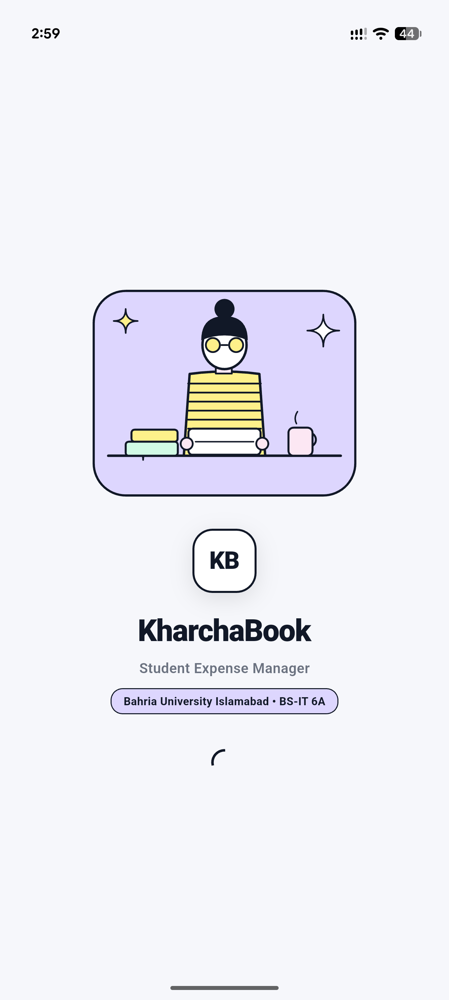
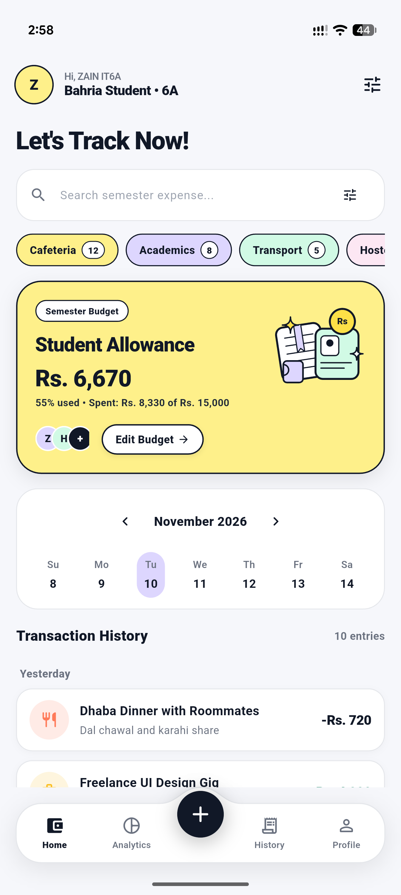
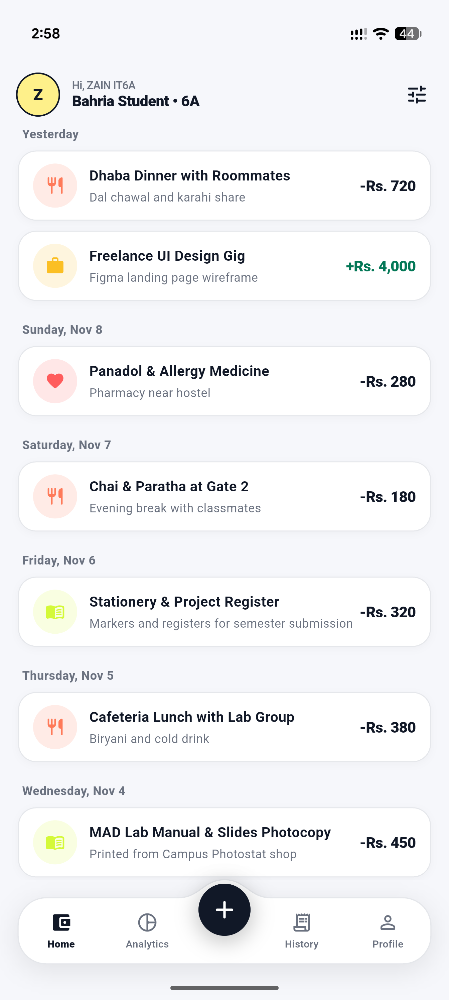
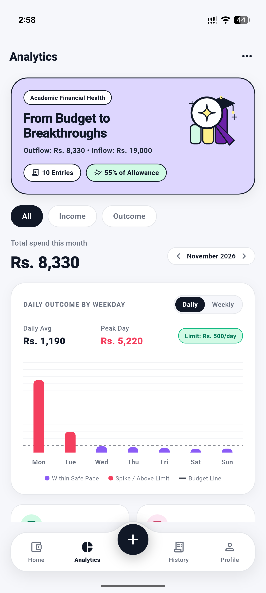
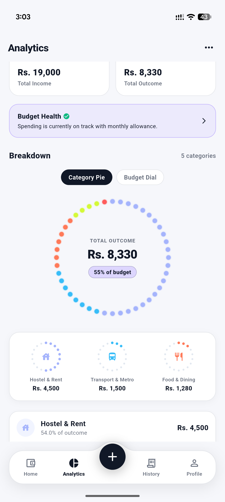
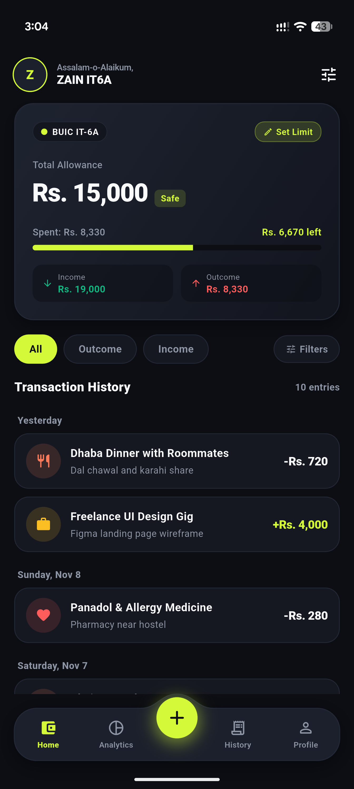
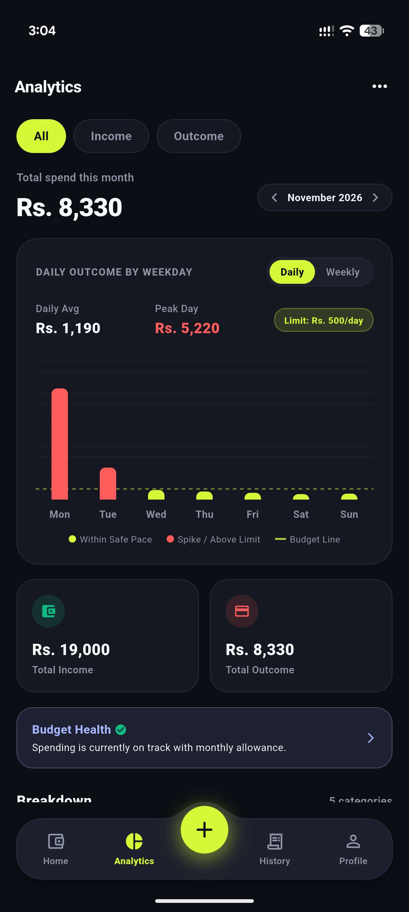
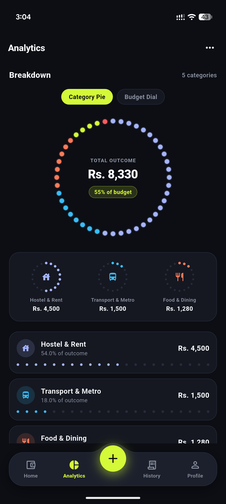

<div align="center">

# 📚 KharchaBook — Student Expense Manager

**A lightweight, student-centric expense manager engineered with Flutter, featuring bespoke editorial design, handcrafted unclipped vector illustrations, tactile dot-matrix visualizers, and calibrated dual-theme aesthetics.**

[](https://flutter.dev)
[](https://dart.dev)
[](https://android.com)
[-success?logo=android&logoColor=white)](https://github.com/D3MONOXXIZZ/kharchabook/releases/tag/v1.0.0)
[](LICENSE)

[Overview](#-overview) • [Key Features](#-key-features) • [Screenshots](#-visual-showcase--screenshots) • [Design System](#-bespoke-design-system) • [Architecture](#-architecture--tech-stack) • [Installation](#-getting-started) • [Authors](#-authors--maintainers)

</div>

---

## 🎯 Overview

University students living on monthly allowances, hostel mess charges, and commuting budgets face friction logging cash transactions: generic corporate banking apps are cluttered, ad-heavy, and disconnected from academic budgets.

**KharchaBook** gives students an ultra-fast way to record expenses in under 10 seconds, track daily burn rates against monthly allowances, and explore financial health through tangible visuals.

> **Milestone:** Complete UI & Front-End Design System.

---

## ✨ Key Features

- 🎨 **Dual-Theme Aesthetic Architecture:**
  - **Editorial Pastel Mode (Light Default):** Warm off-white canvas (`#F7F6F2`), solid ink typography (`#111827`), intentional pastel semantic containers (Buttercup Yellow, Lilac Lavender, Soft Mint, Soft Coral), and handcrafted unclipped vector illustrations.
  - **OLED Dark Neo-Fintech Mode (Dark):** True OLED pitch-black canvas (`#0A0B0E`), dark elevated card surfaces (`#151821`), and signature electric Volt Lime accents (`#D4F938`).
- 🛸 **Custom Arched Floating Dock:** Hand-drawn Bezier curve dome navigation dock (`ArchedDockPainter`) with an elevated 52×52 action button (`+`) and 4 symmetrical tabs (Home, Analytics, History, Profile).
- 🔘 **Tactile Circular Dot Matrix Pie Chart:** Analog-inspired circular ring of 44 discrete circular dots visually representing category spending shares and budget consumption.
- 📊 **Dynamic Daily Spending Trend Chart:** Dual-view bar chart (Daily vs Weekly view toggle) comparing daily burn rates with the daily allowance threshold (Rs. 500/day limit line), highlighting spending spikes in warning rose.
- 📅 **Weekly Calendar Strip:** Interactive horizontal day-picker widget allowing instant day-by-day cash flow inspection.
- 🎨 **Unclipped Student Vector Art:** Pure Dart `CustomPainter` illustrations depicting graduation caps, semester ledgers, student ID cards, campus chai mugs, and study desk scenes.
- ⚡ **Rapid Recording Modal:** PKR amount hero input with quick increment pills (`+50`, `+100`, `+500`, `+1000`), category picker grid, and date selector.

---

## 📱 Visual Showcase & Screenshots

### 1. Editorial Pastel Theme (Light Mode)

| **S1: Student Splash Screen** | **S4: Student Expense Dashboard** | **S4/S8: Transaction History Feed** |
|:---:|:---:|:---:|
|  |  |  |
| *Study desk scene, monogram badge & auto-router* | *Let's Track Now!, Yellow Hero allowance card & calendar* | *Grouped daily transactions with category badges* |

| **S6: Spending Trend Chart (Top)** | **S6: Dot Matrix Breakdown (Bottom)** |
|:---:|:---:|
|  |  |
| *Lavender breakthrough card, weekday bar chart & daily pace* | *Circular Dot Matrix ring, KPI cards & category meters* |

---

### 2. OLED Dark Neo-Fintech Theme (Dark Mode)

| **S4: Dashboard (OLED Dark)** | **S6: Trend Chart (OLED Dark)** | **S6: Dot Matrix Breakdown (OLED Dark)** |
|:---:|:---:|:---:|
|  |  |  |
| *Virtual student allowance card & volt lime indicators* | *High-contrast spending chart with spike detection* | *Glowing neon matrix ring & discrete category meters* |

---

## 🎨 Bespoke Design System

### Color Token Reference

| Semantic Token | Editorial Pastel (Light) | OLED Dark Neo-Fintech | Purpose |
|:---|:---:|:---:|:---|
| `Canvas / Background` | `#F7F6F2` | `#0A0B0E` | Main application screen backdrop |
| `Card Surfaces` | `#FFFFFF` | `#151821` | Content enclosure surfaces |
| `Primary Typography` | `#111827` (Ink Black) | `#F8FAFC` (Pure White) | Headings, balances, and titles |
| `Secondary Typography` | `#64748B` (Muted Slate) | `#94A3B8` (Medium Slate) | Subtitles, labels, and timestamps |
| `Accent / Volt Lime` | `#111827` / `#D4F938` | `#D4F938` (Electric Lime) | Primary action pills & neon glow |
| `Pastel Yellow` | `#FDE047` | — | Semester allowance hero card |
| `Pastel Lavender` | `#DDD6FE` | — | Academic breakthrough hero card |
| `Inflow / Outflow` | `#10B981` / `#F43F5E` | `#10B981` / `#F43F5E` | Income green vs expense rose |

---

## 🏗️ Architecture & Tech Stack

```
lib/
├── core/
│   ├── constants/       # AppDimensions, typography scales
│   ├── theme/           # AppColors, AppTheme (light/dark definitions)
│   └── utils/           # CurrencyFormatter, DateFormatter
├── data/
│   └── mock/            # MockAuthRepository, MockExpenseRepository
├── domain/
│   ├── models/          # Expense, Category, MonthlyBudgetSummary, Profile
│   └── repositories/    # Abstract AuthRepository & ExpenseRepository interfaces
└── presentation/
    ├── providers/       # ThemeProvider, AuthProvider, ExpenseProvider
    ├── screens/
    │   ├── splash/      # Screen S1: Illustrated Student Splash Screen
    │   ├── auth/        # Screen S2: Login & Screen S3: Register
    │   ├── dashboard/   # Screen S4: Home Hub + Widgets (Hero Card, Calendar Strip)
    │   ├── stats/       # Screen S6: Analytics + Widgets (Trend Chart, Dot Matrix)
    │   ├── transactions/# Screen S8: Dedicated Transaction Ledger
    │   ├── profile/     # Screen S7: Profile & Theme Mode Switcher
    │   └── expense_form/# Screen S5: Add/Edit Expense & Income Modal
    └── widgets/
        ├── illustrations/# Handcrafted CustomPainters (Student, Cap, Ledger, Piggy)
        └── [Buttons, TextFields, Badges]
```

- **Framework:** Flutter 3.22+ (Dart 3.4+)
- **State Management:** Provider (`ChangeNotifierProvider`)
- **Data Visualization:** `fl_chart` + Bespoke Canvas CustomPainters
- **Architectural Pattern:** Layered Domain-Driven Clean Architecture (UI strictly separated from data access)

---

## 🚀 Getting Started

### Prerequisites

- [Flutter SDK](https://docs.flutter.dev/get-started/install) (`>= 3.22.0`)
- [Android Studio](https://developer.android.com/studio) or [VS Code](https://code.visualstudio.com/) with Flutter extension
- Android Device or Emulator running Android 8.0+ (API 26+)

### Installation & Run

1. **Clone the repository:**
   ```bash
   git clone https://github.com/D3MONOXXIZZ/kharchabook.git
   cd kharchabook
   ```

2. **Install Flutter dependencies:**
   ```bash
   flutter pub get
   ```

3. **Run the app in debug mode:**
   ```bash
   flutter run
   ```

4. **Run automated tests & linter:**
   ```bash
   flutter test
   flutter analyze
   ```

5. **Build Release APK:**
   ```bash
   flutter build apk --release
   ```
   The standalone output APK is generated at `build/app/outputs/flutter-apk/app-release.apk`.

---

## 👥 Authors & Maintainers

- **Zain Kashif** (Lead Mobile & UI Developer)
- **Huraira Minhas** (UI Architecture & State Specialist)

---

## 📄 License

This project is open-source under the [MIT License](LICENSE).
